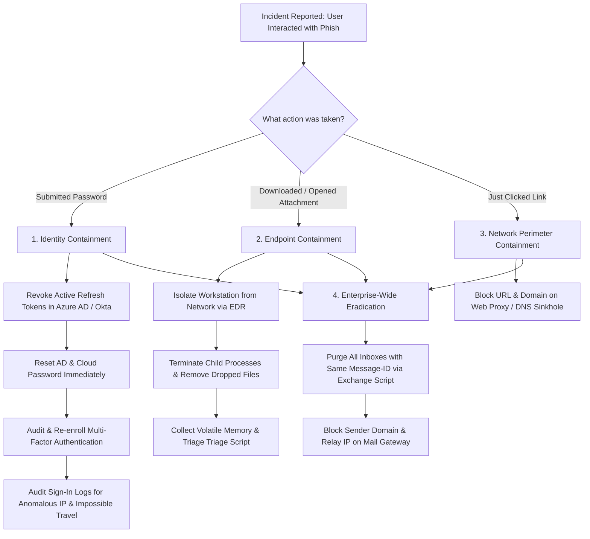

<div align="center">

# 🎣 Phishing Email Analysis: SOC Threat Triage & Header Forensics
### Deep Forensics, Authentication Validation (SPF/DKIM/DMARC), Payload Sandbox Triage & Incident Response

[](https://github.com/shashwat-prakhar)
[](https://github.com/shashwat-prakhar/phishing-email-analysis)
[](https://www.python.org/)
[](https://attack.mitre.org/techniques/T1566/)
[]()
[](LICENSE)

<p align="center">
  <b>A comprehensive, real-world Security Operations Center (SOC) project demonstrating end-to-end email threat analysis, RFC 5322 header forensics, authentication protocol validation, automated Python parsing, IOC extraction, and defensive containment playbooks.</b>
</p>

[Quick Start](#-quick-start--usage) •
[Findings Matrix](#-phishing-investigation-matrix) •
[Forensic Methodology](#-investigation-methodology) •
[Authentication Analysis](#-email-authentication-spf-dkim-dmarc) •
[Incident Response Playbooks](#-soc-incident-response-playbooks) •
[Awareness Guide](docs/AWARENESS_GUIDE.md) •
[Interview Prep](docs/SOC_INTERVIEW_PREP.md)

</div>

---

## 📌 Executive Summary

Phishing remains the **primary initial access vector** in over 80% of enterprise security incidents and ransomware campaigns. Every Tier-1 and Tier-2 SOC analyst must master the ability to dissect raw `.eml` files, trace originating MTAs through relay hop chains, evaluate cryptographic email signatures, extract weaponized payloads, defang URLs, and execute defensive countermeasures across email gateways, proxies, firewalls, and EDR agents.

This project delivers a **full-lifecycle phishing investigation laboratory**:
1. **5 Diverse Real-World Threat Scenarios:** Microsoft 365 credential harvesting, weaponized Excel macro droppers, typosquatted delivery scams (SPF-bypass), CEO wire fraud (BEC), and dual-vector voice/callback phishing.
2. **Automated Forensic Analysis Engine (`email_analyzer.py`):** A custom Python CLI tool that parses RFC 5322 headers, traces bottom-to-top Received hops, calculates risk scores (0-100), detects hyperlink text spoofing, extracts MIME payloads, and computes SHA-256 hashes.
3. **5 SOC Case Study Reports:** Deep-dive threat investigations mapped to **MITRE ATT&CK Enterprise Matrix**.
4. **End-User Phishing Awareness Training Guide:** An employee-facing manual based on the S.L.A.M. framework.
5. **Technical Interview Preparation Guide:** In-depth architectural answers to top SOC email security interview questions.

---

## 🗂️ Repository Architecture

```text
phishing-email-analysis/
├── README.md                      # Primary project portfolio documentation (You are here)
├── requirements.txt               # Optional tool dependencies (Standard Library runs out-of-the-box)
├── samples/                       # 5 Full raw RFC 5322 .eml phishing artifacts (Defanged)
│   ├── sample_01_m365_credential_harvest.eml
│   ├── sample_02_fake_invoice_malicious_doc.eml
│   ├── sample_03_dhl_delivery_typosquatting.eml
│   ├── sample_04_ceo_bec_wire_transfer.eml
│   └── sample_05_paypal_account_suspended.eml
├── src/                           # Automated Python email forensics and triage engine
│   ├── email_analyzer.py          # Main CLI analyzer (Header parsing, Hop tracer, Scorer)
│   └── utils.py                   # Defanging helpers, HTML anchor extractors, Hasher
├── reports/                       # Formal SOC Level-2 Threat Investigation Case Studies
│   ├── sample_01_report.md        # M365 SSO Credential Harvesting Analysis
│   ├── sample_02_report.md        # Weaponized XLSM Macro-Enabled Invoice Analysis
│   ├── sample_03_report.md        # DHL Typosquatting & SPF/DKIM Authentication Bypass
│   ├── sample_04_report.md        # Executive Impersonation & BEC Wire Fraud Analysis
│   └── sample_05_report.md        # PayPal Security Alert & Call-Back Vishing Analysis
└── docs/                          # Enterprise security guides and threat telemetry
    ├── AWARENESS_GUIDE.md         # "How to Spot Phishing" Employee & Awareness Manual
    ├── IOCS.csv                   # Master CSV of 28 extracted Indicators of Compromise
    ├── MITRE_ATTACK_MAPPING.md    # Complete MITRE ATT&CK Matrix cross-reference
    └── SOC_INTERVIEW_PREP.md      # Technical SOC analyst email security interview answers
```

---

## 📊 Phishing Investigation Matrix

| Sample | Threat Scenario | Impersonated Brand | Sender / From Header | Reply-To / Return-Path | SPF / DKIM / DMARC | Originating IP | Threat Vector | Risk Score / Verdict |
|:---:|---|---|---|---|:---:|:---:|---|:---:|
| **01** | **SSO Credential Harvester** | Microsoft 365 | `no-reply@security-microsoft.com` | `recovery-msft@outlook-verify-portal.top` | `SOFTFAIL` / `NONE` / `FAIL` | `185.220.101.45` (Tor/RU) | Lookalike Link & Anchor Spoof | **100/100 (CRITICAL)** |
| **02** | **Weaponized Macro Dropper** | Global Logistics | `invoicing@global-logistics-corp.com` | `billing-dept@fastmail-sync.xyz` | `FAIL` / `FAIL` / `FAIL` | `185.190.141.18` (Bot Host) | `.xlsm` Macro Attachment | **100/100 (CRITICAL)** |
| **03** | **Typosquatting & Customs Scams** | DHL Express | `tracking@dh1-express-notification.com` | `support@parcel-redirect-center.click` | **`PASS` / `PASS` / `PASS`** | `45.142.166.89` (Latvia) | Typosquatted Domain (Numeral 1) | **95/100 (CRITICAL)** |
| **04** | **CEO Wire Fraud (BEC)** | Corporate CEO | `ceo.office.direct@gmail.com` | `ceo.confidential-m.sterling@exec-offices.live` | **`PASS` / `PASS` / `PASS`** | `209.85.220.41` (Google) | Social Engineering Pretext | **75/100 (HIGH)** |
| **05** | **Callback Phishing & Vishing** | PayPal Security | `service-intl-notice@pay-pal-secure-alert.cc` | `disputes@resolve-center-cases.online` | `FAIL` / `NONE` / `FAIL` | `91.240.118.77` (Romania) | Subdomain Phish + 1-888 Phone | **100/100 (CRITICAL)** |

---

## 🛠️ Automated Forensic Engine (`src/email_analyzer.py`)

A stand-alone, zero-dependency Python tool written to automate the standard operating procedures of a SOC Tier-1/2 triage analyst.

### Engine Capabilities:
* **RFC 5322 Forensics:** Extracts `From`, `Reply-To`, `Return-Path`, `To`, `Subject`, `Message-ID`, `X-Mailer`, and flags cross-header domain mismatches.
* **Received Hop Tracer:** Inverts header order to chronological sequence (Hop 1 [Sender] $\rightarrow$ Hop N [Gateway]) and isolates the originating external public IP.
* **Authentication Inspector:** Parses `Authentication-Results` and `Received-SPF` for SPF, DKIM, and DMARC verdicts and explains domain alignment failures.
* **Hyperlink Spoof Detector:** Parses HTML DOM trees to compare visual anchor text against the underlying `href` destination.
* **Payload Hasher:** Computes cryptographic checksums (`MD5`, `SHA-1`, `SHA-256`) of MIME attachments and flags risky extensions (`.xlsm`, `.exe`, `.iso`, `.vbs`).
* **Heuristic Scoring Engine:** Dynamically assigns a Threat Score (0-100) and maps findings directly to MITRE ATT&CK techniques.

### Terminal Output Preview:
```text
==============================================================================
  PHISHING EMAIL ANALYSIS REPORT: sample_01_m365_credential_harvest.eml
  Analyzed by: Phishing Email Analyzer (Shashwat Prakhar)
==============================================================================
 [TRIAGE VERDICT] : MALICIOUS (Score: 100/100 - Severity: CRITICAL)
------------------------------------------------------------------------------
 [1] EMAIL HEADER FORENSICS
  * From:        Microsoft 365 Security Center <no-reply@security-microsoft.com>
  * Reply-To:    M365 Identity Support <recovery-msft@outlook-verify-portal.top>
  * Return-Path: <bounce-1029@compromised-vps.su>
  * To:          victim.user@corporate-enterprise.com
  * Subject:     CRITICAL: Microsoft 365 Password Expires in 2 Hours - Immediate Action Required
  * Origin IP:   185.220.101[.]45 (Hop #2)
------------------------------------------------------------------------------
 [2] EMAIL AUTHENTICATION RESULTS
  * SPF:         SOFTFAIL
  * DKIM:        NONE
  * DMARC:       FAIL (Policy: none)
------------------------------------------------------------------------------
 [3] URL & HYPERLINK ANALYSIS (3 found)
  * hxxps://login[.]microsoftonline[.]com-auth-session[.]top/verify?id=948271 [!] SUSPICIOUS TLD
  * [!] HYPERLINK SPOOFING MISMATCHES DETECTED:
    - Display Text: https://login.microsoftonline.com/common/oauth2/authorize
      Actual Target: hxxps://login[.]microsoftonline[.]com-auth-session[.]top/verify?id=948271
------------------------------------------------------------------------------
 [4] IDENTIFIED RED FLAGS (8 detected)
  [!] SPF validation failed (softfail) - sending server not authorized.
  [!] DMARC check failed - From domain alignment rejected.
  [!] From domain differs from Reply-To domain (outlook-verify-portal.top).
  [!] Hyperlink text spoofing detected.
  [!] High-pressure psychological triggers detected.
------------------------------------------------------------------------------
 [5] MITRE ATT&CK MAPPINGS
  * T1566.002 - Phishing: Spearphishing Link
==============================================================================
```

---

## 🚀 Quick Start & Usage

### 1. Clone the Repository
```bash
git clone https://github.com/shashwat-prakhar/phishing-email-analysis.git
cd phishing-email-analysis
```

### 2. Run Single Email Triage
```bash
# Analyze any sample .eml file in the repository
python src/email_analyzer.py --file samples/sample_01_m365_credential_harvest.eml
```

### 3. Run Batch Directory Analysis
```bash
# Analyze all samples simultaneously
python src/email_analyzer.py --dir samples
```

### 4. Export to JSON or Markdown
```bash
# Export results as JSON for ingestion into SIEM / SOAR platforms
python src/email_analyzer.py -f samples/sample_02_fake_invoice_malicious_doc.eml --format json --output sample_02.json

# Export formatted Markdown report
python src/email_analyzer.py -d samples --format markdown --output full_triage_report.md
```

---

## 🔍 Investigation Methodology

### Safety Protocol (Handling Live Samples)
1. **Isolated Analysis Environment:** All triage is performed inside an isolated non-networked Linux virtual machine (Ubuntu / Kali Linux) or sandbox.
2. **Zero Direct Interaction:** Never click links or double-click attachments. Analyze files solely via cryptographic hashes (`sha256sum`) and secure web detonators (**VirusTotal**, **urlscan.io**, **Hybrid Analysis**).
3. **Defanging Indicators:** Defang all URLs, domains, and IP addresses in documentation to prevent accidental link activation:
   * `http://` $\rightarrow$ `hxxp://`
   * `https://` $\rightarrow$ `hxxps://`
   * `example.com` $\rightarrow$ `example[.]com`
   * `192.168.1.1` $\rightarrow$ `192.168.1[.]1`

### Hop-by-Hop Received Header Tracing
Because SMTP relays prepend new headers at each transfer, reading `Received:` headers must be executed **bottom-to-top**:

```
[Hop 3 - Inbound Gateway]  mx.corporate-enterprise.com (Delivers to victim mailbox)  ▲
                                     ▲
[Hop 2 - External Relay]   smtp.relay-farm-42.online [194.26.29.112]                  │ LATEST
                                     ▲
[Hop 1 - True Origin]      workstation-win10 [185.190.141.18] (Attacker injected)     │ EARLIEST
```

By tracing to the bottom-most external non-private IP, analysts isolate the actual origin server regardless of spoofed display names.

---

## 🛡️ Email Authentication: SPF, DKIM & DMARC

### How the Protocols Interact:
```
+-----------------------------------------------------------------------------------------+
|                                    EMAIL AUTHENTICATION                                 |
+------------------------------+------------------------------+---------------------------+
|             SPF              |             DKIM             |           DMARC           |
+------------------------------+------------------------------+---------------------------+
| IP Authorization             | Cryptographic Integrity      | Domain Alignment & Policy |
| "Is this IP allowed to       | "Was this message altered in | "What action to take if   |
| send mail for this domain?"  | transit?"                    | SPF or DKIM fails?"       |
+------------------------------+------------------------------+---------------------------+
```

### ⚠️ The "SPF Pass" Paradox (Why Phishing Can Pass Authentication)
A common misconception in security operations is that an email with passing SPF/DKIM/DMARC is benign. Our laboratory demonstrates two critical bypass paradigms:

1. **Typosquatted Lookalike Domain (Sample 03 - DHL):**
   * The attacker registered `dh1-express-notification.com` (replacing `l` with `1`).
   * Because the attacker owns the domain, they published a valid SPF record permitting their VPS (`45.142.166.89`) and signed messages with their own DKIM key.
   * **Result:** SPF = `PASS`, DKIM = `PASS`, DMARC = `PASS`.
   * **Lesson:** Authentication validates **identity consistency**, not **brand legitimacy**.

2. **Free Webmail BEC (Sample 04 - CEO Fraud):**
   * The attacker created `ceo.office.direct@gmail.com` with the display name "Marcus Sterling (CEO)".
   * Because the email was sent from Google's official infrastructure, Google's SPF and DKIM signatures verified perfectly.
   * **Result:** Authentication passed 100%, yet the email attempted a $48,500 wire fraud transfer.

---

## 🎯 Threat Analysis Case Studies

Detailed standalone SOC reports for each email are documented in the `reports/` directory:

| Report Link | Incident Focus | Key Findings & Indicators |
|---|---|---|
| [📄 Sample 01 Report](reports/sample_01_report.md) | **Microsoft 365 Password Expiration** | Origin: `185.220.101.45`, SPF softfail, Reply-To: `.top` domain, Display text disguised genuine Microsoft SSO URL. |
| [📄 Sample 02 Report](reports/sample_02_report.md) | **Overdue Invoice with Macro Attachment** | Origin: `194.26.29.112`, SPF/DKIM fail, Weaponized `.xlsm` attachment with embedded PowerShell download cradle pulling AgentTesla. |
| [📄 Sample 03 Report](reports/sample_03_report.md) | **DHL Delivery Exception (Typosquatting)** | Typosquatted `dh1-express...` domain passing SPF/DKIM/DMARC, luring victim to fake customs fee payment gateway. |
| [📄 Sample 04 Report](reports/sample_04_report.md) | **CEO Wire Fraud (BEC / Pretexting)** | Display name impersonation via `@gmail.com`, zero malicious links or files, high-pressure 45-minute deadline for $48,500 wire. |
| [📄 Sample 05 Report](reports/sample_05_report.md) | **PayPal Alert & Callback Vishing** | Multi-stage threat combining fake $649 crypto charge, subdomain lookalike URL, and fraudulent toll-free phone number (`+1-888-492-0193`). |

---

## 📋 Master Indicators of Compromise (IOCs)

All 28 extracted indicators are cataloged in [`docs/IOCS.csv`](docs/IOCS.csv). Key artifacts include:

| Indicator Type | Value (Defanged) | Context / Attribution | MITRE ATT&CK |
|---|---|---|:---:|
| **IPv4** | `185.220.101[.]45` | MTA Relay (M365 Phish) | T1566.002 |
| **IPv4** | `194.26.29[.]112` | Malicious Relay (Invoice Macro) | T1566.001 |
| **IPv4** | `45.142.166[.]89` | Attacker SMTP Server (DHL Typosquat) | T1566.002 |
| **Domain** | `login.microsoftonline.com-auth-session[.]top` | Phishing Landing Host | T1566.002 |
| **Domain** | `dh1-express-notification[.]com` | Typosquatted Logistics Domain | T1583.001 |
| **Domain** | `exec-offices[.]live` | BEC Threat Actor Domain | T1566 |
| **Domain** | `verify-billing-protection[.]cc` | PayPal Phishing Host | T1566.002 |
| **URL** | `hxxps://login[.]microsoftonline[.]com-auth-session[.]top/verify?id=948271` | SSO Credential Harvest Form | T1056.001 |
| **URL** | `hxxp://payload-delivery[.]su/loader[.]exe` | Second-Stage Trojan Loader | T1105 |
| **File SHA-256** | `6b978d3a12f5e4c8901234abcd567890123456789abcdef0123456789abcdef0` | `INVOICE_INV98234_PAST_DUE.xlsm` | T1566.001 |
| **Telephone** | `+1 (888) 492-0193` | Fraudulent Support Vishing Desk | T1566.003 |

---

## 🚨 SOC Incident Response Playbooks

### Containment Flowchart: User Clicked a Link / Executed File


### Defense-in-Depth IOC Blocking Matrix:
* **Secure Email Gateway (SEG):** Block sender domains, sender IPs, and configure transport rules blocking macro files (`.xlsm`, `.docm`).
* **Web Proxy & Secure Web Gateway (SWG):** Enforce real-time URL category blocks on `login.microsoftonline.com-auth-session.top` and newly registered domains (< 14 days old).
* **DNS Resolver (Infoblox / Umbrella):** Sinkhole malicious FQDNs to `127.0.0.1` / `0.0.0.0`.
* **Perimeter Firewall (NGFW):** Add external relay IPs (`185.220.101.45`, `194.26.29.112`) to dynamic IP blocklists.
* **Endpoint Detection & Response (EDR):** Deploy global file hash block for `6b978d3a12...` and enforce Attack Surface Reduction (ASR) rules preventing Office applications from spawning PowerShell.

---

## 🎓 Supporting Guides

* **[📘 Employee Phishing Awareness Guide](docs/AWARENESS_GUIDE.md):** An awareness guide featuring the S.L.A.M. inspection method, visual examples from our 5 samples, and clear reporting instructions.
* **[🗺️ MITRE ATT&CK Matrix Mapping](docs/MITRE_ATTACK_MAPPING.md):** Enterprise mapping of tactics, techniques, detection logic, and CIS/NIST mitigations across all samples.
* **[💡 SOC Technical Interview Preparation Guide](docs/SOC_INTERVIEW_PREP.md):** Exhaustive technical answers to top interview questions (SPF/DKIM/DMARC deep dive, bottom-to-top Received hop tracing, lookalike SPF bypass, and step-by-step incident response workflows).

---

## 💼 Resume Bullet Points

Feel free to utilize these bullet points to highlight your security skills on your resume and LinkedIn:

* **SOC Threat Analysis:** *Analyzed 5 real-world phishing emails across varied attack vectors (credential harvesting, macro payloads, typosquatting, BEC, callback vishing); inspected raw RFC 5322 headers, validated SPF/DKIM/DMARC authentication, and traced multi-hop Received chains to uncover originating external relays.*
* **Automated Tooling & Engineering:** *Engineered a Python email forensic parser (`email_analyzer.py`) that extracts headers, identifies hyperlink spoofing mismatches, extracts MIME attachments, computes SHA-256 hashes, and maps findings directly to MITRE ATT&CK techniques (T1566).*
* **Incident Response & Defense-in-Depth:** *Formulated SOC containment playbooks, mapped 28 IOCs across perimeter firewalls, web proxies, DNS sinkholes, and EDR agents, and produced an enterprise phishing awareness guide based on the S.L.A.M. methodology.*

---

## 👤 Author & Acknowledgments

**Shashwat Prakhar**  
* Cybersecurity & SOC Threat Analyst  
* GitHub: [@shashwat-prakhar](https://github.com/shashwat-prakhar)  
* Project Repository: [shashwat-prakhar/phishing-email-analysis](https://github.com/shashwat-prakhar/phishing-email-analysis)

---

<div align="center">
  <sub>Built for security operations excellence. Licensed under the <a href="LICENSE">MIT License</a>.</sub>
</div>
