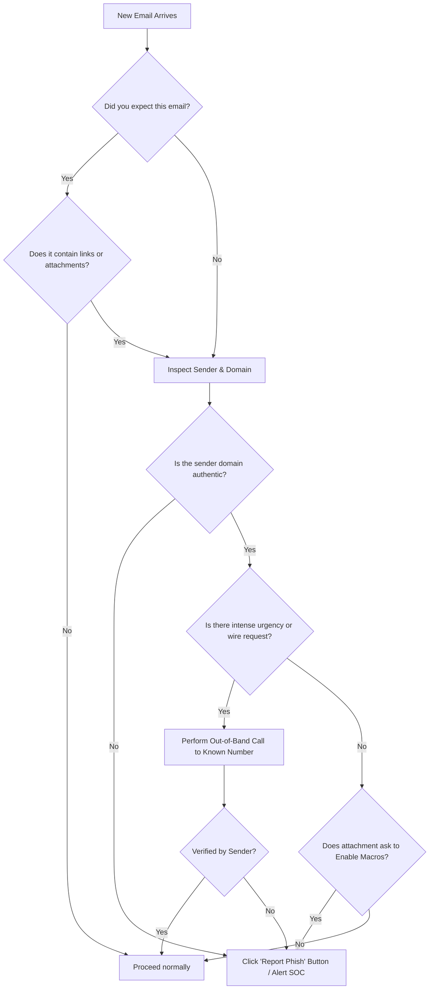

# How to Spot Phishing: Enterprise Security Awareness Guide
**Author:** Shashwat Prakhar | Security Operations Center (SOC)  
**Target Audience:** Enterprise Employees, Security Champions & IT Personnel

---

## 1. Introduction: The Phishing Threat
Phishing remains the **#1 initial attack vector** for enterprise data breaches, ransomware deployments, and financial fraud. Cybercriminals no longer rely solely on poorly worded generic emails; modern phishing attacks feature pixel-perfect brand counterfeiting, typosquatted lookalike domains, and psychological manipulation.

This guide provides practical techniques to identify, verify, and safely report phishing attempts before harm occurs.

---

## 2. The S.L.A.M. Inspection Framework
When reviewing any unexpected or sensitive incoming email, apply the **S.L.A.M.** rule:

```
  S - SENDER      --> Inspect the full email address, not just the display name
  L - LINKS       --> Hover to inspect the true URL destination before clicking
  A - ATTACHMENTS --> Never enable macros or execute unexpected file formats
  M - MESSAGE     --> Be skeptical of high urgency, fear, secrecy, or financial demands
```

---

## 3. Deep Dive: The 4 Critical Pillars

### [S] Sender: Look Beyond the Display Name
Attackers manipulate the **Friendly Display Name** in email clients because mobile devices and modern desktop clients often hide the real underlying email address.

```
Display Name (Fake):   "Microsoft 365 Security Team"
Actual Email (Real):   <no-reply@security-microsoft.com>  <-- Unverified domain!
Reply-To Address:     <recovery-msft@outlook-verify-portal.top>  <-- Attacker inbox!
```

#### What to Check:
1. **Look at the Domain:** Is the email coming from `@company.com` or a public free webmail provider like `@gmail.com` or `@outlook.com`?
2. **Watch for Typosquatting (Lookalikes):**
   * Legitimate: `dhl.com`
   * Typosquatted: `dh1-express-notification.com` (using the number `1` instead of `l`)
   * Legitimate: `paypal.com`
   * Impersonation: `paypal.com.verify-billing-protection.cc` (subdomain trickery)
3. **Check the Reply-To Header:** Does hitting "Reply" send your message to a different address than the sender?

---

### [L] Links: Hover Before You Click
Hyperlinks can display one text string while navigating your browser to a completely different server.

```
Visual Text Seen in Email:  https://login.microsoftonline.com/authorize
Actual Web Address (href):  https://login.microsoftonline.com-auth-session.top/verify?id=948271
```

#### Best Practices:
* **Hover (Desktop):** Place your mouse cursor over the link *without clicking* to view the preview box in the lower-left corner of your mail client.
* **Long Press (Mobile):** Tap and hold the link to preview the full URL destination.
* **Read From Right to Left:** Find the first single forward slash (`/`) and look immediately to the left. That reveals the true root domain.
  * In `https://login.microsoftonline.com.attacker-site.com/login`, the real domain is **`attacker-site.com`**, NOT Microsoft!

---

### [A] Attachments: The Trojan Horse
Files attached to emails are the primary delivery vehicle for trojans, info-stealers, and ransomware.

```
DANGEROUS EXTENSIONS:
.xlsm / .docm  --> Macro-enabled Office files that execute embedded malicious code
.iso / .img    --> Disk image containers used to bypass gateway email scanners
.exe / .scr    --> Direct executable binaries
.vbs / .js     --> Scripting files that trigger background PowerShell downloaders
```

#### Golden Rule on Macros:
> [!CAUTION]
> If a document opens and asks you to click **"Enable Content"** or **"Enable Editing"** to view "encrypted", "protected", or "accounting" content, **STOP IMMEDIATELY**. Microsoft Office never requires enabling macros to decrypt a legitimate invoice.

---

### [M] Message: Psychological Manipulation & Red Flags
Phishing relies on social engineering to bypass critical thinking. Watch for these common psychological hooks:

| Tactic | Attacker Message Examples | Goal |
|---|---|---|
| **Artificial Urgency** | "Password expires in 2 hours", "Account suspended in 24 hours" | Forces hasty action without second-guessing. |
| **Authority / Fear** | "Directive from the CEO", "Legal subpoena notice", "Collections agency" | Exploits fear of reprimand or insubordination. |
| **Secrecy / Isolation**| "Strictly confidential - do not discuss with colleagues or call me" | Prevents the victim from validating with coworkers. |
| **Financial Alarmism**| "Unauthorized $649 Bitcoin purchase detected on your card" | Causes panic, forcing victim to dispute via fake phone/link. |

---

## 4. Real-World Case Studies (From Our SOC Lab)

````carousel
### Case 1: The Urgent Credential Harvester

* **Pretext:** Your password expires in 2 hours.
* **Red Flag:** Display name claims Microsoft, but Reply-To ends in `.top`.
* **Link Trick:** Text shows genuine Microsoft link; underlying href links to `login.microsoftonline.com-auth-session[.]top`.
<!-- slide -->
### Case 2: The Macro-Enabled Invoice

* **Pretext:** Overdue shipping invoice past due 45 days.
* **Red Flag:** Attached file is `.xlsm`. Body prompts to "Enable Content".
* **Hidden Action:** VBA script runs background PowerShell to download infostealer Trojan.
<!-- slide -->
### Case 3: The Typosquatted Delivery Alert

* **Pretext:** Package held for unpaid $2.49 customs fee.
* **Red Flag:** Look closely at the domain: `dh1-express...` (numeral 1 instead of lowercase L).
* **Deception:** Passes SPF/DKIM because attacker bought the lookalike domain!
<!-- slide -->
### Case 4: The CEO Wire Transfer Fraud (BEC)

* **Pretext:** Confidential M&A acquisition, wire $48,500 immediately.
* **Red Flag:** CEO's name sent from `@gmail.com`. Reply-To goes to `exec-offices[.]live`.
* **Zero Links/Files:** Relies 100% on executive authority and secrecy.
````

---

## 5. Decision Flowchart: What To Do When You Receive an Email



---

## 6. Safe Reporting Protocol
If you suspect an email is phishing:
1. **DO NOT CLICK** any links, open attachments, or reply.
2. **DO NOT FORWARD** the email to colleagues (this spreads the risk).
3. **CLICK** the official corporate **"Report Phishing"** button in Outlook/Gmail toolbar.
4. If you inadvertently clicked a link or submitted credentials:
   - **Immediately contact the SOC Hotline** or IT Helpdesk.
   - **Disconnect your computer from Wi-Fi / Ethernet** if an attachment was opened.
   - **Change your corporate password** from a separate, known-clean device.
