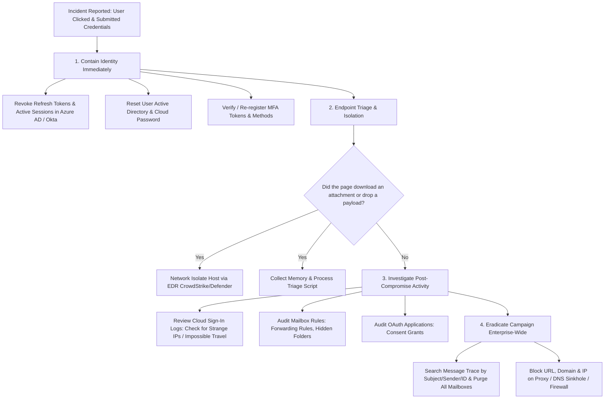

# SOC Analyst Technical Interview Preparation: Email Security
**Author:** Shashwat Prakhar | Security Operations Center (SOC)  
**Repository:** [shashwat-prakhar/phishing-email-analysis](https://github.com/shashwat-prakhar/phishing-email-analysis)

---

## Question 1: What is the exact difference between SPF, DKIM, and DMARC? How do they work together?

### Core Answer:
SPF, DKIM, and DMARC are complementary email authentication protocols designed to verify sender identity, prevent spoofing, and enforce domain integrity.

```
+-----------------------------------------------------------------------------------------+
|                                    EMAIL AUTHENTICATION                                 |
+------------------------------+------------------------------+---------------------------+
|             SPF              |             DKIM             |           DMARC           |
| (Sender Policy Framework)    | (DomainKeys Identified Mail) | (Domain-based Auth,       |
|                              |                              |  Reporting & Conformance) |
+------------------------------+------------------------------+---------------------------+
| IP Authorization             | Cryptographic Integrity      | Domain Alignment & Policy |
| "Is this IP allowed to       | "Was this message tampered   | "What should the receiver |
| send mail for this domain?"  | with in transit?"            | do if SPF or DKIM fails?" |
+------------------------------+------------------------------+---------------------------+
```

### 1. SPF (Sender Policy Framework - RFC 7208)
* **What it does:** Allows a domain owner to publish a DNS TXT record listing all IP addresses and mail servers authorized to send emails on behalf of that domain (`Return-Path` / Envelope From / `MAIL FROM`).
* **Example DNS Record:**
  ```text
  example.com. IN TXT "v=spf1 ip4:192.0.2.1 include:_spf.google.com ~all"
  ```
* **Mechanisms:** `+all` (pass anyone - dangerous), `?all` (neutral), `~all` (softfail - accept but mark suspicious), `-all` (hardfail - strictly reject unauthorized IPs).
* **Limitation:** SPF only verifies the **Envelope From** (`Return-Path`), NOT the **Header From** (`From:`) that end-users see in their email client! It also breaks when emails are forwarded.

### 2. DKIM (DomainKeys Identified Mail - RFC 6376)
* **What it does:** Adds an asymmetric cryptographic digital signature to the email header (`DKIM-Signature`), ensuring that the email body and critical headers were not altered or tampered with in transit.
* **How it works:**
  1. The sending MTA hashes selected headers and message body, encrypts the hash using the domain's **Private Key**, and embeds it in the `DKIM-Signature` header.
  2. The receiving MTA fetches the sender domain's **Public Key** via DNS (using a selector: `selector._domainkey.domain.com`) and decrypts the signature to verify the hash matches.
* **Limitation:** DKIM verifies cryptographic integrity, but does not guarantee the `From:` display header is trustworthy, nor does it specify what action to take if verification fails.

### 3. DMARC (RFC 7489)
* **What it does:** Solves the weaknesses of SPF and DKIM by requiring **Domain Alignment** and establishing an enforcement policy.
* **Alignment Requirement:** The domain in the visible `From:` header must match (align with) the domain validated by SPF (`Return-Path`) AND/OR the domain validated by DKIM (`d=domain.com`).
* **Policies (`p=`):**
  * `p=none`: Monitor and report only; deliver message to inbox.
  * `p=quarantine`: Send failed messages to Spam/Junk folder or gateway quarantine.
  * `p=reject`: Drop/reject the email at the mail gateway boundary before delivery.
* **Reporting:** Generates aggregate (`rua`) and forensic (`ruf`) XML telemetry back to the domain owner.

---

## Question 2: How do you read `Received` headers, and in which chronological order?

### Core Answer:
`Received` headers are read **from bottom to top** (chronological order from origin to final destination).

### Why?
Every time an email is transferred between Mail Transfer Agents (MTAs), the receiving server prepends a new `Received:` header to the top of the message. 
* The **bottom-most** `Received:` header was written first by the initial relay/server that accepted the email from the sender.
* The **top-most** `Received:` header was written last by the recipient's internal boundary mail gateway.

```
[Top of Header]    Received: by internal-mx.victimcorp.com ... (FINAL INBOUND HOP)   ^  LATEST
                   Received: by filter.gateway-security.com ...                      |
                   Received: by smtp.relay-farm-42.online ...                        |
[Bottom of Header] Received: from workstation [185.190.141.18] ... (TRUE ORIGIN)    |  EARLIEST
```

### Forensic Analysis Process:
1. Scroll to the **bottom-most `Received:` line**.
2. Identify the `from` hostname and IP address.
3. Check if the IP is private (RFC 1918: `10.x.x.x`, `172.16-31.x.x`, `192.168.x.x` or loopback `127.0.0.1`). If private, move up to the first public external IP address.
4. Compare timestamps across hops to check for anomalous delivery delays (often indicating routing through intermediate proxy relays or botnets).
5. Cross-reference the true external IP against **AbuseIPDB**, **VirusTotal**, and **Shodan**.

---

## Question 3: An email passes SPF, DKIM, and DMARC, but is still a phishing attack. How is this possible?

### Core Answer:
This is a standard scenario in modern threat campaigns. SPF, DKIM, and DMARC authenticate **domain identity**, NOT **intent or legitimacy**. There are 4 primary ways this occurs:

1. **Typosquatting / Lookalike Domains (Attacker owns the domain):**
   * *Example:* As demonstrated in **Sample 03**, the attacker registered `dh1-express-notification.com` (using numeral `1`).
   * Because the attacker owns the DNS zone, they published their own valid SPF record permitting their VPS IP, and signed messages with their own valid DKIM key. SPF, DKIM, and DMARC all passed with flying colors!
2. **Business Email Compromise (BEC) via Legitimate Webmail:**
   * *Example:* As demonstrated in **Sample 04**, the attacker created a free Gmail account `ceo.office.direct@gmail.com` with display name "Marcus Sterling (CEO)".
   * Because Google sent the message from its own authorized servers with authentic Google DKIM signatures, all authentication checks passed 100%.
3. **Compromised Legitimate Corporate Accounts (Account Takeover - ATO):**
   * If an attacker compromises a vendor's M365 account via credential stuffing or session cookie hijacking, emails sent from that account originate from the legitimate corporate tenant and pass all authentication.
4. **Subdomain Hijacking / Dangling DNS Records:**
   * If an enterprise fails to clean up dangling DNS records (e.g., forgotten SendGrid or Mailgun CNAMEs pointing to abandoned cloud resources), an attacker can claim that subdomain and send authenticated emails.

---

## Question 4: A user reports they clicked a phishing link and submitted their password. What is your step-by-step incident response playbook?

### Step-by-Step SOC Playbook:



### Detailed Breakdown:

#### Phase 1: Contain Identity (Minutes 0 - 15)
1. **Revoke Active User Sessions:** In Microsoft Entra ID (Azure AD) or Okta, trigger `"Revoke user sessions"` immediately to invalidate active refresh tokens, cookies, and OAuth sessions.
2. **Mandatory Password Reset:** Reset corporate Active Directory and SSO passwords. Ensure temporary password requires immediate change on first login.
3. **Audit Multi-Factor Authentication (MFA):** Check whether the attacker added an unauthorized MFA device (FIDO2 key, authenticator app, phone number). Re-enroll user MFA from a verified secure station.

#### Phase 2: Endpoint Assessment (Minutes 15 - 30)
1. **Determine Payload Status:** Did the landing page download a file (`.exe`, `.iso`, `.xlsm`, `.zip`) or execute a browser exploit?
2. If an attachment or executable was executed, **network-isolate the workstation** immediately via EDR (CrowdStrike Falcon / Microsoft Defender for Endpoint).
3. Run a full endpoint behavioral scan and inspect browser download history.

#### Phase 3: Scope and Impact Analysis (Minutes 30 - 60)
1. **Examine Sign-In Logs:** Query Entra ID Sign-In logs for the user's account starting from the time of the credential submission. Look for:
   * Successful logins from unrecognized external IPs or anomalous countries (Impossible Travel).
   * Anomalous User-Agent strings.
   * Access attempts to SharePoint, OneDrive, or internal HR/Payroll applications.
2. **Inspect Mailbox Rules (BEC Check):** Threat actors immediately set up hidden forwarding rules (e.g., forward incoming emails with keywords "invoice", "payment", "bank" to an external address, or move incoming SOC notifications to the RSS/Deleted Items folder).
3. **Review OAuth Grants:** Check if the user authorized a malicious Enterprise Application (Illusive consent grant).

#### Phase 4: Eradication & Enterprise Protection (Minutes 60 - 90)
1. **Tenant-Wide Message Purge:** Run an Exchange PowerShell query:
   ```powershell
   New-ComplianceSearch -Name "PurgePhish-INC001" -ExchangeLocation All -ContentMatchQuery 'Subject:"CRITICAL: Microsoft 365 Password Expires*"'
   Start-ComplianceSearch -Identity "PurgePhish-INC001"
   New-ComplianceSearchAction -SearchName "PurgePhish-INC001" -Purge -PurgeType HardDelete
   ```
2. **Block IOCs:** Block the sender IP, domain, and URL across all security layers (Gateway, Web Proxy, DNS, EDR).

---

## Question 5: What Indicators of Compromise (IOCs) would you extract, and exactly where in the enterprise security architecture would you block them?

### Core Answer:
A SOC analyst must practice **Defense-in-Depth**. Blocking an IOC at only one layer leaves vulnerabilities elsewhere.

```
+-----------------------------------------------------------------------------------------------+
|                               DEFENSE-IN-DEPTH IOC BLOCKING MATRIX                            |
+-------------------+----------------------------+----------------------------------------------+
| Security Layer    | IOC Type to Block          | Enforcement Mechanism / Tool                 |
+-------------------+----------------------------+----------------------------------------------+
| Secure Email      | Sender Email, From Domain, | Mail Gateway Transport Rule, Anti-Phish      |
| Gateway (SEG)     | Reply-To Domain, IPs,      | Policy (M365 Defender, Proofpoint, Mimecast) |
|                   | Subject Keywords           |                                              |
+-------------------+----------------------------+----------------------------------------------+
| Web Proxy / SWG   | Target URLs, Phishing      | Secure Web Gateway (Zscaler, Cisco Umbrella, |
|                   | Domains, Newly Registered  | BlueCoat) SSL Decryption & Block Category    |
+-------------------+----------------------------+----------------------------------------------+
| DNS Resolver      | Malicious FQDNs,           | DNS Sinkholing (Infoblox, Pi-hole, Cloudflare|
|                   | C2 Dropper Domains         | 1.1.1.2) - Return 0.0.0.0 / Loopback         |
+-------------------+----------------------------+----------------------------------------------+
| Perimeter         | Originating Malicious IPs, | Next-Gen Firewall (Palo Alto, Fortinet)      |
| Firewall (NGFW)   | External C2 Server IPs     | Dynamic Threat Feeds & Inbound/Outbound ACL  |
+-------------------+----------------------------+----------------------------------------------+
| Endpoint Detection| File Hashes (SHA-256, MD5),| EDR IOC Blacklist (CrowdStrike, Defender,    |
| & Response (EDR)  | Process Names, Mutexes     | SentinelOne) - Custom Detection Rules        |
+-------------------+----------------------------+----------------------------------------------+
| Identity / IdP    | Compromised User Accounts, | Microsoft Entra ID / Okta Conditional Access |
|                   | Threat Actor Geo-Locations | Risk-Based Policies & IP Named Locations     |
+-------------------+----------------------------+----------------------------------------------+
```

### Applied Examples From Our Project:

1. **Target URL (`login.microsoftonline.com-auth-session.top`):**
   * Blocked on **Web Proxy (Zscaler)** to prevent any internal user from opening the page.
   * Sinkholed on **Enterprise DNS** to resolve to internal isolation sinkhole (`127.0.0.1`).
2. **File Hash (`6b978d3a12f5e4c8901234abcd567890123456789abcdef...`):**
   * Added to **EDR (CrowdStrike / Defender)** global blocklist to kill processes and quarantine files instantly upon write.
3. **Sender Domain (`dh1-express-notification.com`):**
   * Added to **Secure Email Gateway** blocklist and configured inbound content filter with Levenshtein distance check for brand typosquats.
4. **Relay IP (`185.220.101.45`):**
   * Added to **Perimeter Firewall** drop rules and Email Gateway IP reputation blocklist.
