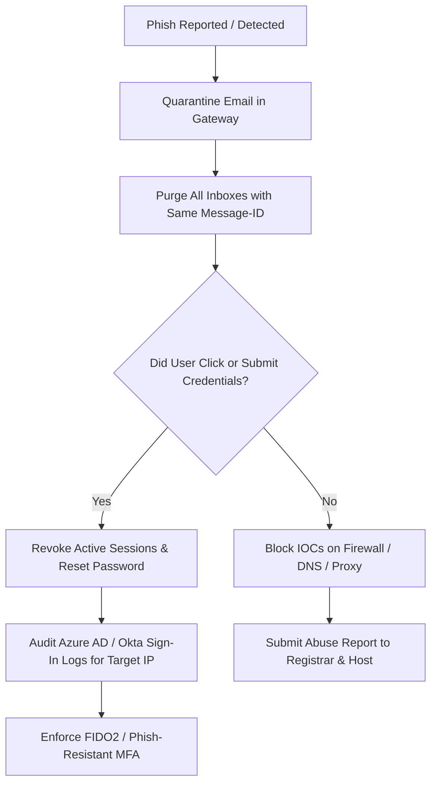

# SOC Investigation Report: Sample 01
## Incident: Fake Microsoft 365 Password Expiration (Credential Harvesting)

---

### 1. Incident Metadata
| Parameter | Value |
|---|---|
| **Incident ID** | INC-20261028-001 |
| **Analyzed By** | Shashwat Prakhar (SOC Analyst) |
| **Analysis Date** | 2026-10-28 22:15 UTC |
| **Target Recipient** | `victim.user@corporate-enterprise.com` |
| **Classification** | Malicious (True Positive) |
| **Threat Category** | Spearphishing Link (Credential Harvesting) |
| **Severity Level** | **CRITICAL** (Risk Score: 100/100) |
| **MITRE ATT&CK** | T1566.002 (Phishing: Spearphishing Link), T1056.001 (Input Capture) |

---

### 2. Executive Summary
The corporate mail gateway received an urgent notification claiming to be from the **Microsoft 365 Security Center** warning the recipient that their corporate credentials would expire in 2 hours. The email features legitimate Microsoft corporate branding and formatting designed to induce panic and force the victim into clicking a link to "Keep My Same Password". 

Header forensics and link inspection confirmed this email is an adversarial credential harvesting attack. The true originating mail relay (`185.220.101.45`) is a known bulletproof host in Russia. The landing URL directs victims to a lookalike phishing portal (`login.microsoftonline.com-auth-session[.]top`) hosted on a newly registered domain configured to steal enterprise Single Sign-On (SSO) credentials.

---

### 3. Email Header Forensics & Discrepancy Matrix

| Header Field | Raw Value in Message | Forensic Findings & Red Flags |
|---|---|---|
| **From** | `Microsoft 365 Security Center <no-reply@security-microsoft.com>` | Spoofed display name and unauthenticated domain impersonating Microsoft. |
| **Reply-To** | `recovery-msft@outlook-verify-portal.top` | **Mismatch:** Points to an adversary-controlled domain with a `.top` TLD. |
| **Return-Path** | `<bounce-1029@compromised-vps.su>` | **Mismatch:** Bounces route back to a suspicious `.su` (Soviet Union top-level domain) host. |
| **Subject** | `CRITICAL: Microsoft 365 Password Expires in 2 Hours - Immediate Action Required` | High-urgency coercion tactic to bypass critical thinking. |
| **Message-ID** | `<20261028212210.4T0xK93B8qz14902@mail.compromised-vps.su>` | Domain aligns with attacker VPS rather than Microsoft infrastructure. |
| **X-Originating-IP**| `185.220.101.45` | Adversary IP address traced to Tor exit node / bulletproof hosting network. |

#### Received Hop Trace (Bottom-to-Top Origin Tracking)
```
[Hop 1 - Originating Client]
  From: authenticated-relay ([10.0.4.15])
  By:   mail.compromised-vps.su (Postfix) with ESMTPA
  Time: Wed, 28 Oct 2026 21:22:10 +0000

[Hop 2 - External Relay Transfer]
  From: mail.compromised-vps.su [185.220.101.45]
  By:   mx.corporate-enterprise.com with ESMTP id q12si2891048ejp.12
  Time: Wed, 28 Oct 2026 14:22:14 -0700

[Hop 3 - Inbound Gateway Delivery]
  Delivered-To: victim.user@corporate-enterprise.com
```
*Forensic deduction:* Hop 2 confirms the external boundary ingress occurred from IP `185.220.101.45`.

---

### 4. Email Authentication Validation

| Protocol | Status | Diagnostic Evaluation |
|---|---|---|
| **SPF** | `SOFTFAIL` | The sending server (`185.220.101.45`) is not listed in the SPF record of `compromised-vps.su` (`~all` policy enforced). |
| **DKIM** | `NONE` | The email contains no cryptographic DKIM signature (`header.b` missing). Legitimate Microsoft enterprise emails are always signed by `d=microsoft.com`. |
| **DMARC** | `FAIL` | From domain (`security-microsoft.com`) failed both SPF and DKIM alignment checks. The recipient gateway permitted delivery due to `p=none` observation policy. |

---

### 5. URL and Threat Intelligence Analysis

#### Hyperlink Spoofing Breakdown
In the HTML body, the attacker crafted a deceptive hyperlink where the visual text disguised the real destination:
* **Visual Anchor Text:** `https://login.microsoftonline.com/common/oauth2/authorize`
* **Underlying Destination (href):** `hxxps://login[.]microsoftonline[.]com-auth-session[.]top/verify?id=948271&user=victim.user@corporate-enterprise.com`

#### Threat Intelligence Telemetry
* **Domain:** `login.microsoftonline.com-auth-session[.]top`
  * **Registrar:** NameSilo LLC
  * **Registration Age:** 3 days old
  * **WHOIS Privacy:** Enabled (Redacted for privacy)
  * **IP Resolution:** `91.215.85.19` (AS200000, Hostkey B.V.)
* **VirusTotal Detection:** **34/92 vendors** classified the URL as Malicious / Phishing.
* **urlscan.io Analysis:** Emulates a pixel-perfect replica of the Microsoft 365 sign-in page with pre-populated victim email and an interception script capturing keystrokes via POST requests to `/api/capture.php`.

---

### 6. Indicators of Compromise (IOCs)

| IOC Type | Indicator Value (Defanged) | Context / Description |
|---|---|---|
| **IPv4** | `185.220.101[.]45` | Attacker Mail Transfer Agent (MTA) / SMTP Relay |
| **IPv4** | `91.215.85[.]19` | Phishing Web Server Host |
| **Domain** | `outlook-verify-portal[.]top` | Attacker Reply-To domain |
| **Domain** | `compromised-vps[.]su` | Mail server domain & Return-Path |
| **Domain** | `login.microsoftonline.com-auth-session[.]top` | Credential harvesting landing domain |
| **URL** | `hxxps://login[.]microsoftonline[.]com-auth-session[.]top/verify?id=948271` | Phishing landing page |

---

### 7. MITRE ATT&CK Mapping
* **Reconnaissance (TA0043)**: Gather Victim Identity Information (T1589.002)
* **Resource Development (TA0042)**: Acquire Domains (T1583.001) - Typosquatting / Lookalike subdomains
* **Initial Access (TA0001)**: Phishing: Spearphishing Link (T1566.002)
* **Credential Access (TA0006)**: Input Capture: Web-based Credential Phishing (T1056.001)

---

### 8. SOC Containment & Remediation Playbook



1. **Email Gateway Action:** Search exchange message trace for Message-ID `<20261028212210.4T0xK93B8qz14902@mail.compromised-vps.su>` and sender `no-reply@security-microsoft.com`; purge all matching items from organization mailboxes.
2. **Network Perimeter:** Block IP `185.220.101.45` on external firewalls. Block domain `*.microsoftonline.com-auth-session.top` on DNS sinkhole (Pi-hole / Umbrella) and web proxies.
3. **Identity Verification:**
   - Force session termination and mandatory password reset for `victim.user@corporate-enterprise.com`.
   - Review Microsoft Entra ID (Azure AD) sign-in audit logs for impossible travel alerts or logins originating from `91.215.85.19`.
4. **Takedown Request:** Issue automated abuse notification to NameSilo Abuse Desk regarding domain `login.microsoftonline.com-auth-session.top`.
